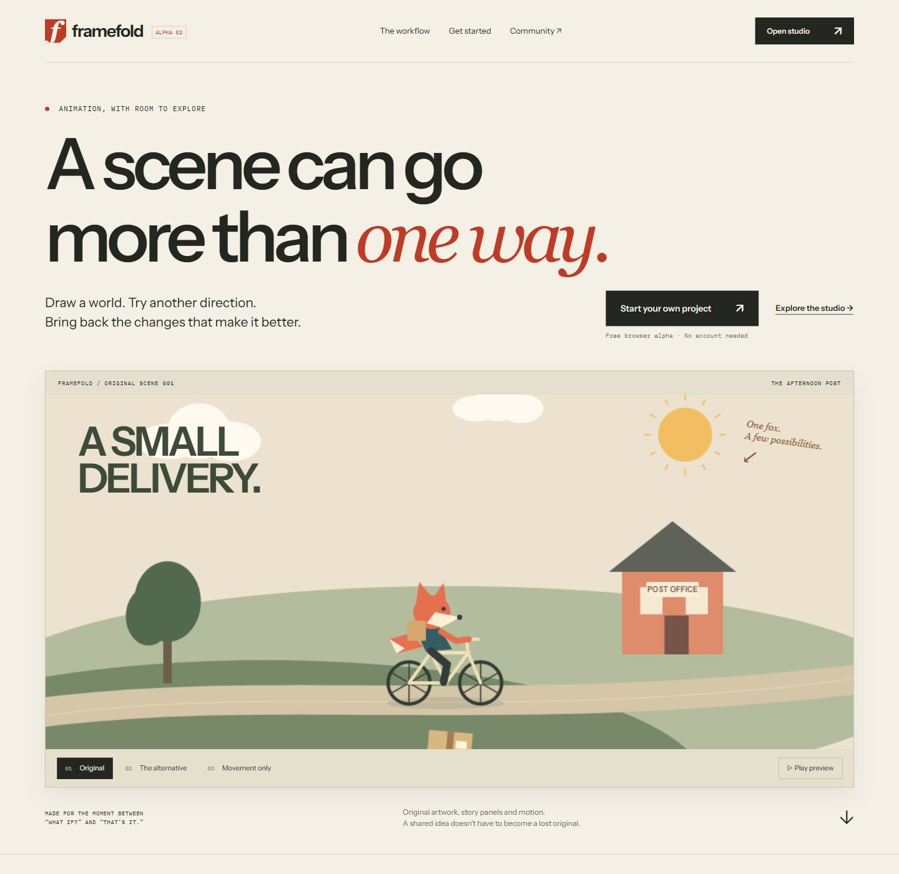
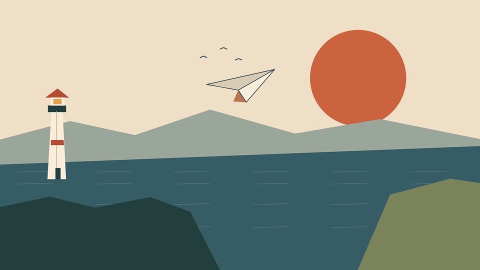
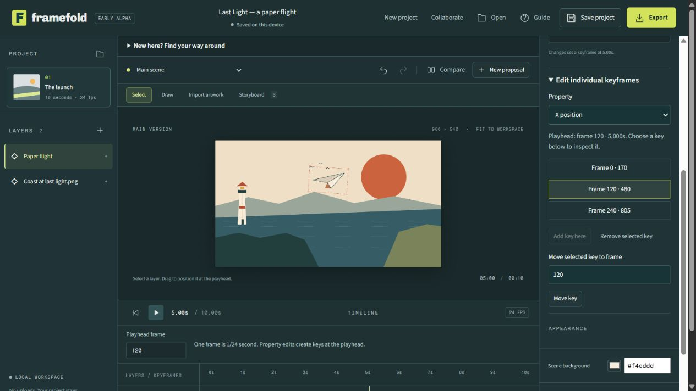
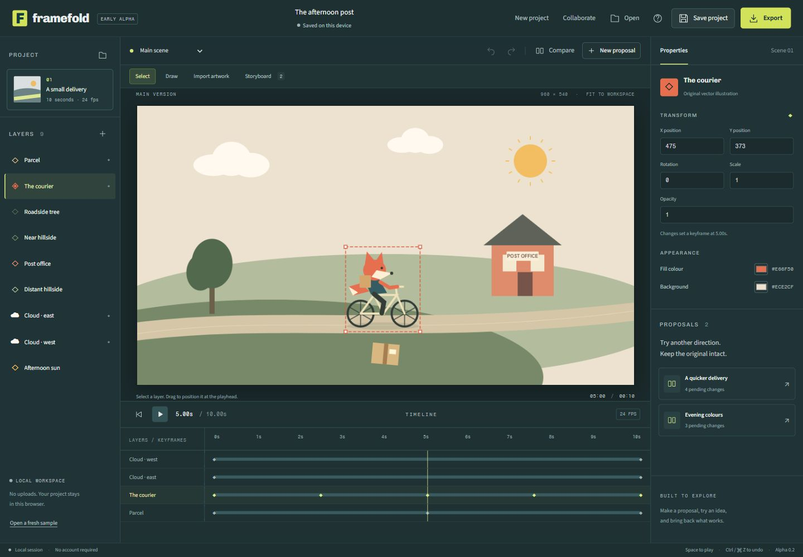
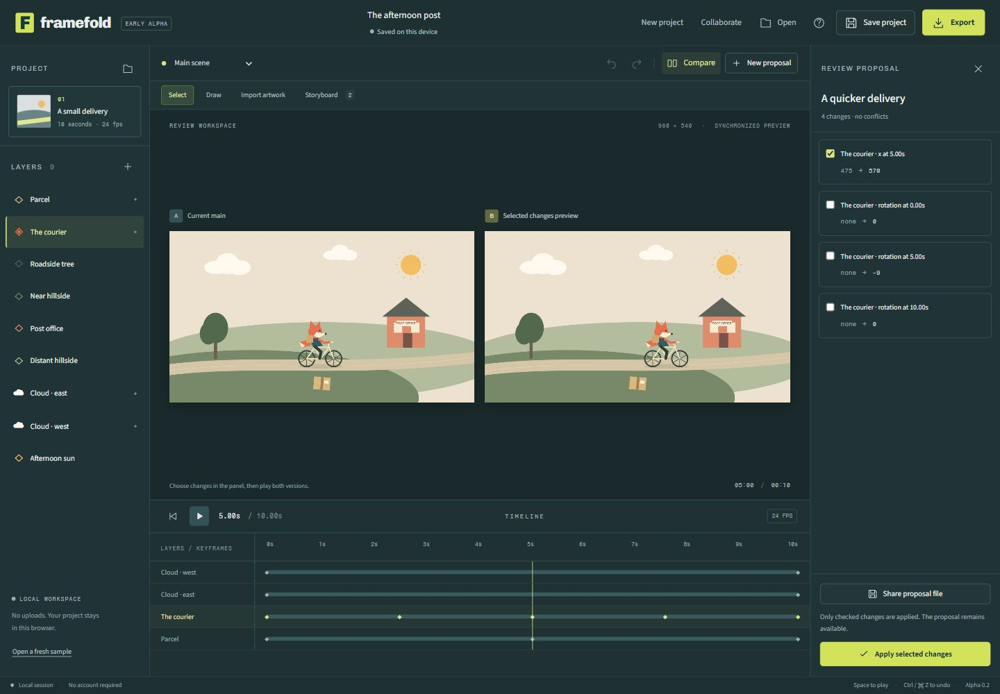

# Framefold

A local-first animation studio for creating scenes, exploring alternatives and reviewing the changes worth keeping.

**Browser alpha 0.3.0 available · Specification-first development · Application source private**

[Open Framefold](https://framefold-psi.vercel.app/) · [First session](GETTING_STARTED.md) · [Roadmap](ROADMAP.md) · [Community discussion](https://github.com/ismaeelakin/framefold-community/discussions)

Framefold starts with a practical creative problem: trying another direction should not mean losing the working version. Make a separate proposal, compare it with the current scene and bring back selected edits. The current alpha does this with local files and basic 2D motion. The longer-term program includes hand-drawn animation, connected 2D/3D production and research into meaningful review of geometry changes.

## Available now

| Work                   | What the alpha supports                                                                             |
| ---------------------- | --------------------------------------------------------------------------------------------------- |
| Make artwork           | Basic sketch layers, shapes and imported PNG/JPEG/WebP artwork                                      |
| Animate a scene        | 960 × 540, 24 fps, ten seconds; position, rotation, uniform scale and opacity with linear keyframes |
| Plan a story           | A first scene and up to twelve additional panels, holds, captured poses and animatic preview        |
| Explore an alternative | Independent proposals, synchronized comparisons, selected changes and explicit conflict choices     |
| Keep editable work     | Browser-local saves, downloaded project files and portable proposal exchange                        |
| Deliver an output      | Still PNG, contact sheet, fixed-frame scene and approved-storyboard WebM (up to 130 seconds)        |

Moving a character illustration is not skeletal or frame-by-frame character animation. The alpha has no cels, easing editor, audio timeline, native 3D, longer shots/transitions, accounts, hosted projects or in-app invitations. Fixed-frame WebM requires a supported browser encoder. Browser storage is not a backup service.

Screenshots show actual alpha interfaces. The individual-key view below is from 0.3.0; older views remain representative of the original sample.

## Try a complete project

[**Last Light**](https://framefold-psi.vercel.app/learn/last-light.html) includes an editable project, the finished scene video and a three-panel storyboard. Open it, inspect the flight keys, scrub the animatic and try your own proposal. All artwork is embedded.

## More control over the scene

Duplicate or remove layers, fit still artwork, enter an exact frame and add/remove/move individual property keys. An occupied destination requires a choice; Undo restores the previous edit. Colours support both the picker and exact hex entry.

The complete approved storyboard can now be delivered as a silent WebM. [Download the eight-second Last Light storyboard](examples/last-light/last-light-storyboard.webm). The tested maximum is thirteen panels /130 seconds; ten-second individual scenes are unchanged.

## Try a selective review

1. Open the studio and the original sample, _The afternoon post_.
2. Review **A quicker delivery**. Keep the courier's position change and leave its rotation changes out.
3. Preview and apply your selection. The main scene gets the movement without the proposed rotation.
4. Download the project. For collaboration, send that file through your usual channel; your collaborator returns a proposal file for you to review.

[Follow the complete guide](GETTING_STARTED.md) · [Use the testing checklist](TESTING.md)

## Where the product is going

The intended product connects **creation, alternatives, review and delivery**. These directions are in the sequence; they are not released capabilities or guaranteed research outcomes.

| Direction                       | Intended result                                                                             | Status                                                         |
| ------------------------------- | ------------------------------------------------------------------------------------------- | -------------------------------------------------------------- |
| Reliable local production       | Recoverable projects, dependable timing and useful finished exports without a cloud account | Foundation work is specified; implementation gate remains open |
| Efficient editable alternatives | Explore branches without copying every asset or losing the original                         | Proposed local foundation                                      |
| Motion-aware review             | Inspect timing, trajectories and poses rather than changed numbers alone                    | Planned, with comprehension testing                            |
| Hand-drawn animation            | Cels, exposures, onion skins, sound and complete shot sequences                             | Planned in separate releases                                   |
| Connected 2D/3D work            | Carry a shot from storyboard to 3D staging to drawn finishing                               | Conditional research                                           |
| Selective 3D review             | Accept meaningful geometry/material/camera changes with explicit dependencies and conflicts | Conditional research                                           |
| Full 3D modelling               | Direct mesh editing, modifiers, sculpting, retopology, UVs and materials                    | Separate research gates for each area                          |

[Complete capability register](FEATURES.md) · [Research and conditions](RESEARCH.md)

## The current development gate

**Specification review comes before further feature coding.** The private engineering set contains 48 proposed capability packets, 149 acceptance recipes and 12 mathematical vectors. Each packet addresses data, interactions, algorithms, limits, failure handling, dependencies and evidence required for release. These counts describe planning coverage, not working features or passing tests.

Archive, codec/muxer, geometry-kernel, device-budget and hosted-service decisions remain open. Three bounded creative operator probes are complete. Layer/key editing and approved-storyboard export have also passed actual-file checks; storage recovery and independent artist usability remain next. [Read how features enter a release](SPECIFICATION.md).

## Architecture and ownership

Today, editing and rendering happen in the browser. People exchange project/proposal files themselves. GitHub hosts the public documentation and discussion; it is not a project-storage or animation-review backend. [Architecture and limits](docs/ARCHITECTURE.md)

The operating constraint is **zero hosting spend**. Local creation/export must remain useful without a service account. Hosted storage, invitations, GitHub feedback sync and audience playback links are conditional on viable free allocations and enforceable limits. There is no promise of unlimited media delivery or free global scale. [Budget rules](docs/ARCHITECTURE.md#zero-spend-boundary)

This is a public documentation and community repository, not the application source. GitHub permits forks of public repositories, including this one. Private source access is separate, and browser-delivered application code can still be inspected. The repository licence does not grant rights to the private implementation or third-party artwork.

## Participate

- [Discussions](https://github.com/ismaeelakin/framefold-community/discussions): artist workflows, questions and work you can safely share.
- [Bug reports](https://github.com/ismaeelakin/framefold-community/issues/new?template=bug_report.yml): reproducible failures in the released alpha.
- [Workflow requests](https://github.com/ismaeelakin/framefold-community/issues/new?template=feature_request.yml): the task and outcome a feature should support.
- [Research proposals](https://github.com/ismaeelakin/framefold-community/issues/new?template=research_proposal.yml): a bounded experiment with evidence and a stop condition.
- Documentation pull requests: corrections, clearer guides and reproducible public examples.

Read [contributing](CONTRIBUTING.md), [community rules](CODE_OF_CONDUCT.md), [privacy](PRIVACY.md), [security](SECURITY.md) and [release notes](CHANGELOG.md). Public attachments can be read by anyone; share only material you have permission to publish.

Maintained by [Ismaeel Habeeb](https://github.com/ismaeelakin). No release date, adoption, investment or acquisition is guaranteed. Framefold remains a working name.
