# Framefold

A local-first animation studio for creating scenes, exploring alternatives and reviewing the changes worth keeping.

**Browser alpha 0.14.0 available · Specification-first development · Application source private**

[Open Framefold](https://framefold-psi.vercel.app/) · [First session](GETTING_STARTED.md) · [Roadmap](ROADMAP.md) · [Community discussion](https://github.com/ismaeelakin/framefold-community/discussions)

Framefold starts with a practical creative problem: trying another direction should not mean losing the working version. Make a separate proposal, compare it with the current scene and bring back selected edits. The current alpha does this with local files and basic 2D motion. The longer-term program includes hand-drawn animation, connected 2D/3D production and research into meaningful review of geometry changes.

## Available now

| Work                   | What the alpha supports                                                                                                |
| ---------------------- | ---------------------------------------------------------------------------------------------------------------------- |
| Make artwork           | Basic sketch layers, shapes and imported PNG/JPEG/WebP artwork                                                         |
| Animate a scene        | 960 × 540, 24 fps, ten seconds; position, rotation, uniform scale and opacity with editable keys and sampled easing    |
| Plan a story           | A first scene and up to twelve additional panels, holds, captured poses and animatic preview                           |
| Explore an alternative | Independent proposals, synchronized comparisons, selected changes and explicit conflict choices                        |
| Keep editable work     | Original workspace save, opt-in recovery, manual project/checkpoint library, JSON files and portable proposal exchange |
| Deliver an output      | Still PNG, contact sheet, fixed-frame scene and approved-storyboard WebM (up to 130 seconds)                           |

Moving a character illustration is not skeletal or frame-by-frame character animation. The alpha has no cels, native curve handles, audio timeline, native 3D, longer shots/transitions, accounts, hosted projects or in-app invitations. Fixed-frame WebM requires a supported browser encoder. Browser storage is not a backup service.

Screenshots show actual alpha interfaces. The individual-key view below is from 0.3.0; older views remain representative of the original sample.

## Start with a scene you can change

Choose **New project** for a blank canvas, an editable moving illustration or a three-beat storyboard. Choose how to keep your current workspace first. Optional Project steps take you to a layer, its five-second pose, proposal review and real export controls. Collapse them or turn them off when starting.

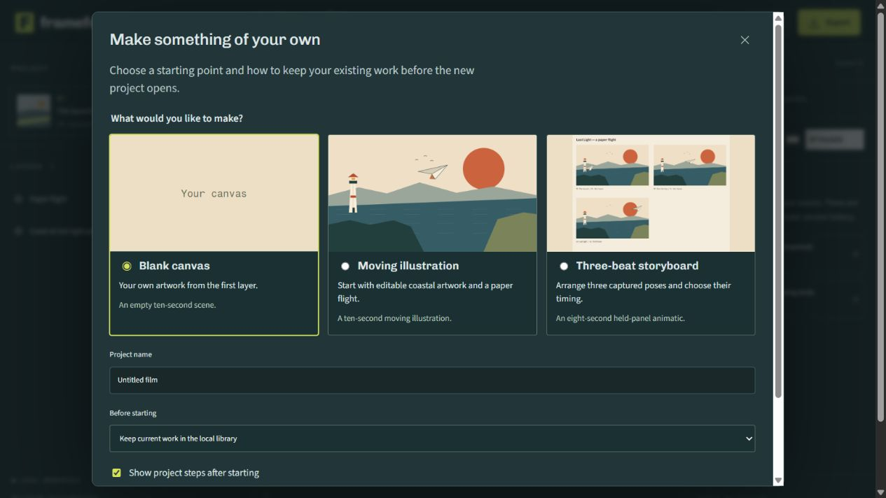

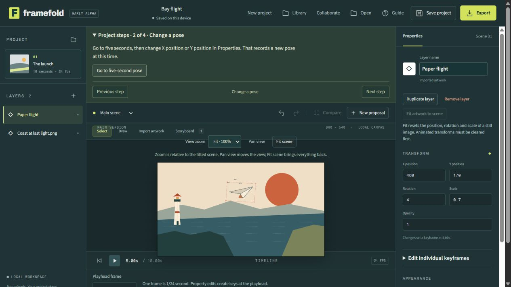

The illustration is ten seconds of layered motion. The storyboard holds three editable still poses for 3/2/3 seconds. They are starting points for your own work, not a frame-by-frame character animation tool. Project steps last for the session and do not enter your saved file.

## Try a complete project

[**Last Light**](https://framefold-psi.vercel.app/learn/last-light.html) includes an editable project, the finished scene video and a three-panel storyboard. Open it, inspect the flight keys, scrub the animatic and try your own proposal. All artwork is embedded.

## More control over the scene

Duplicate or remove layers, fit still artwork, enter an exact frame and add/remove/move individual property keys. An occupied destination requires a choice; Undo restores the previous edit. Colours support both the picker and exact hex entry.

The complete approved storyboard can now be delivered as a silent WebM. [Download the eight-second Last Light storyboard](examples/last-light/last-light-storyboard.webm). The tested maximum is thirteen panels /130 seconds; ten-second individual scenes are unchanged.

## Clean up a sketch without losing later work

Select a drawing layer and choose a stroke in **Sketch strokes**. The canvas outlines that stroke for inspection. **Remove selected stroke** removes the whole stroke; Undo restores it. Other layers and later edits stay intact. Inspection does not change project files or exported images.

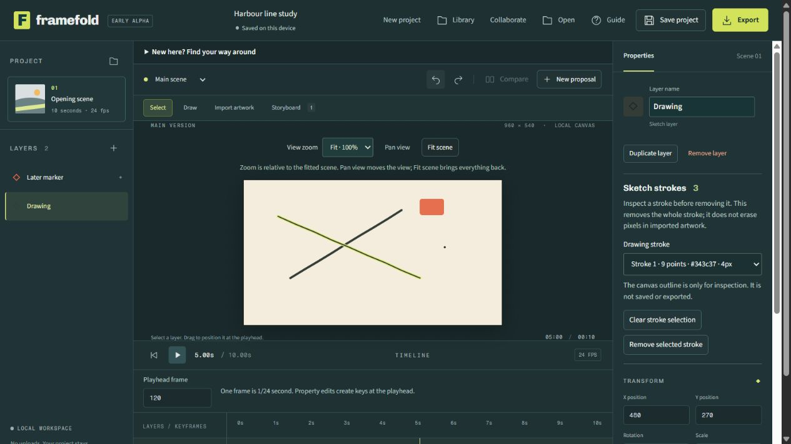

The same cleanup can be tried in a proposal and selectively accepted into the approved scene or panel. Drawing-list edits are reviewed together; this is not a partial eraser, raster editor or per-stroke merge engine. The desktop project guide is also more compact so the canvas and timeline are easier to use together.

## Put artwork in the right order

Select a layer, then use **Move forward**, **Move backward**, **Bring to front** or **Send to back** in Properties. The top layer row is in front. Motion and embedded artwork remain intact; Undo restores the previous order.

Stacking changes also work in proposals. Review shows starting and proposed layer orders alongside synchronized previews. Conflicting order edits require an explicit choice. If the chosen order needs different layers, the operation stops instead of discarding approved work.

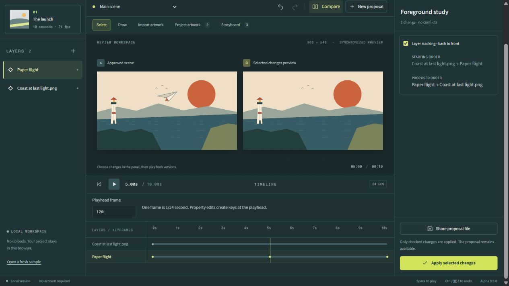

## See the artwork inside a project

**Project artwork** shows embedded images, dimensions, usage in approved scenes and proposals, and their embedded size. Preview an image, download its exact embedded copy, or run **Check embedded artwork**. The memory estimate covers one uncompressed copy, not peak browser memory; keep original uploads separately.

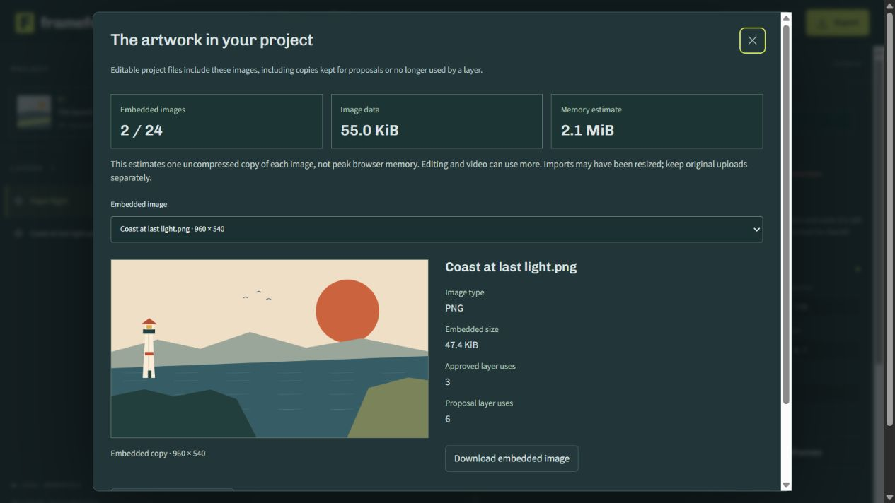

Imports show their progress with **Cancel import**, including on narrow screens. A delayed file read or image decode cannot replace newer edits, a changed target or a newer import. Rendering and exports keep their own prepared images so unrelated image preparation cannot substitute artwork during an export.

## Look closer, keep the scene intact

Use View zoom and Pan view to inspect details. Fit scene returns to the whole composition. Navigation changes the view only: artwork, keys and full-scene exports remain intact. Escape cancels unfinished input.

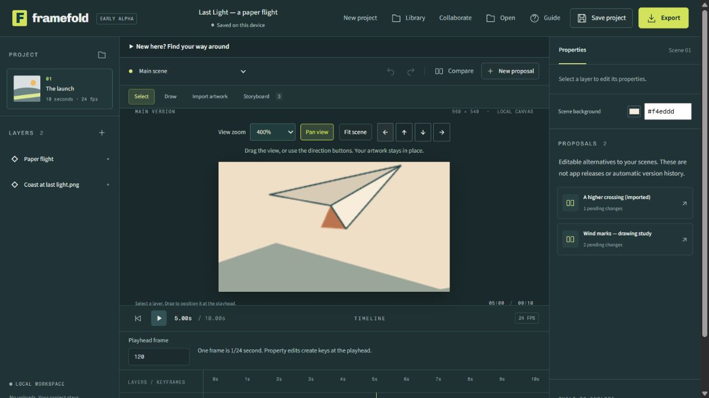

## Keep more than one project

[**Your project library**](https://framefold-psi.vercel.app/#studio/library) keeps manual local checkpoints alongside the automatic workspace save. Name a project, save a milestone, recover an earlier checkpoint as a new entry, or archive and restore work. Returning to identical saved content offers Continue saved project without making another copy.

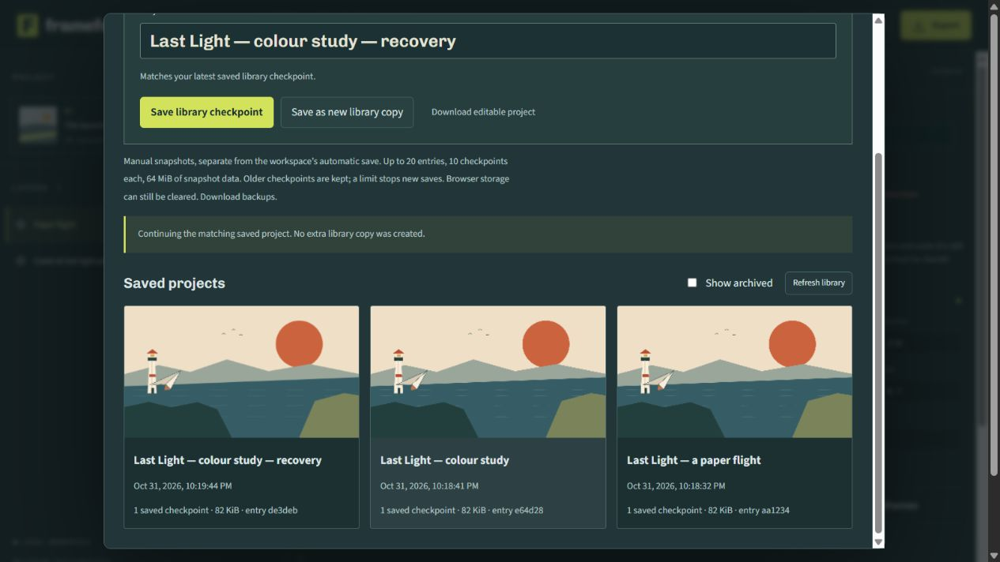

Up to 20 entries including archives, 10 checkpoints each, 8 MiB per snapshot and 64 MiB total snapshot data. Limits preserve existing checkpoints; none are automatically deleted. Browser storage can still be cleared or unavailable, so download backups. This is a bounded manual library, not cloud backup; transactional automatic recovery is a separate opt-in.

## Try a selective review

1. Open the studio and the original sample, _The afternoon post_.
2. Review **A quicker delivery**. Keep the courier's position change and leave its rotation changes out.
3. Preview and apply your selection. The main scene gets the movement without the proposed rotation.
4. Download the project. For collaboration, send that file through your usual channel; your collaborator returns a proposal file for you to review.

[Follow the complete guide](GETTING_STARTED.md) · [Use the testing checklist](TESTING.md)

## Where the product is going

The intended product connects **creation, alternatives, review and delivery**. These directions are in the sequence; they are not released capabilities or guaranteed research outcomes.

| Direction                       | Intended result                                                                             | Status                                                         |
| ------------------------------- | ------------------------------------------------------------------------------------------- | -------------------------------------------------------------- |
| Reliable local production       | Recoverable projects, dependable timing and useful finished exports without a cloud account | Foundation work is specified; implementation gate remains open |
| Efficient editable alternatives | Explore branches without copying every asset or losing the original                         | Proposed local foundation                                      |
| Motion-aware review             | Inspect timing, trajectories and poses rather than changed numbers alone                    | Planned, with comprehension testing                            |
| Hand-drawn animation            | Cels, exposures, onion skins, sound and complete shot sequences                             | Planned in separate releases                                   |
| Connected 2D/3D work            | Carry a shot from storyboard to 3D staging to drawn finishing                               | Conditional research                                           |
| Selective 3D review             | Accept meaningful geometry/material/camera changes with explicit dependencies and conflicts | Conditional research                                           |
| Full 3D modelling               | Direct mesh editing, modifiers, sculpting, retopology, UVs and materials                    | Separate research gates for each area                          |

[Complete capability register](FEATURES.md) · [Research and conditions](RESEARCH.md)

## The current development gate

**Specification review comes before further feature coding.** The private engineering set contains 48 proposed capability packets, 149 acceptance recipes and 12 mathematical vectors. Each packet addresses data, interactions, algorithms, limits, failure handling, dependencies and evidence required for release. These counts describe planning coverage, not working features or passing tests.

Archive, codec/muxer, geometry-kernel, device-budget and hosted-service decisions remain open. Three bounded creative operator probes are complete. Layer/key editing, approved-storyboard export and bounded local workspace recovery have passed actual-file checks; broader storage packages and independent artist usability remain ahead. [Read how features enter a release](SPECIFICATION.md).

## Save, recover and return

In the studio, open **Saving and recovery** to opt into transactional workspace saving. Your original browser save files stay intact. The latest and previous automatic saves have artwork previews and can open as library copies after keeping your current work. Conflicting tabs stop with a clear error instead of silently replacing another save. The homepage resumes an entered workspace while pending saves continue.

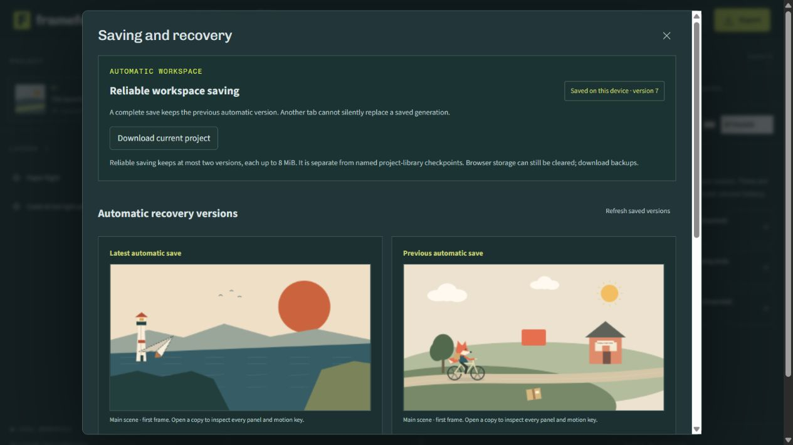

Everything stays local to this website/browser. Automatic recovery keeps two versions up to 8 MiB each, separately from manual library checkpoints. Browser data can still be cleared; download backups. There is no cloud synchronization or unlimited storage.

## Reuse motion without rebuilding it

Select a layer and choose **Open motion workspace**. See the scene beside its motion keys, move the playhead by frame, and copy selected values with their timing gaps. Paste on the same property of another layer, proposal or captured panel. Occupied frames require review before replacement; Undo restores the whole paste.

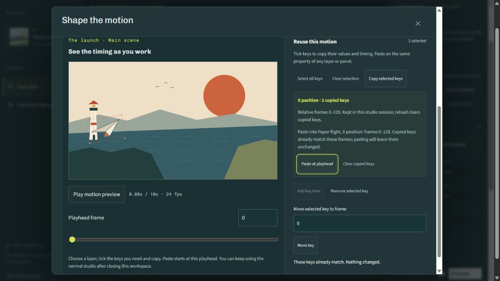

Copied keys stay in this studio session and clear on reload. This does not access your system clipboard or change the project format. Native curve handles, loops and longer scenes remain future work.

## Give movement a different pace

In the motion workspace, select two keys and choose **Shape timing**. Preview a gentle start, finish or both, inspect the movement, then Apply or Cancel. Applying creates editable frame samples between the same endpoint values. Previewing and cancelling leave your project and automatic save unchanged; Undo restores an applied change.

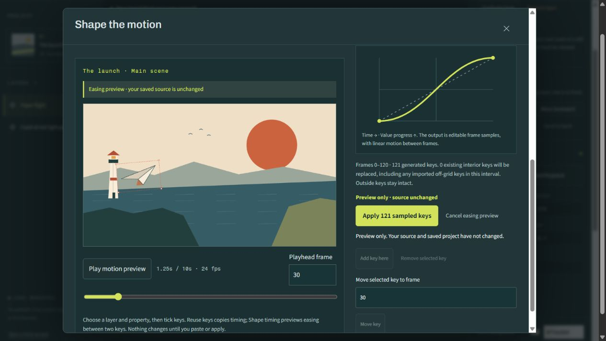

The graph describes timing progress, rather than a drawn motion path. These are sampled numeric keys, with linear movement between frames. Storyboard delivery plays each approved scene from frame zero for its panel hold. A captured pose stays still until you add motion; Scene video delivers the full selected scene. Native editable curve handles and animated shot sequences remain later work.

## Keep a dense timeline readable

After sampled easing, a layer can contain many closely spaced key times. The timeline groups nearby times into counted targets. Choose a numbered group to open that layer’s exact motion controls; no keys are deleted or moved. During review, a group seeks its first key without opening an editing surface.

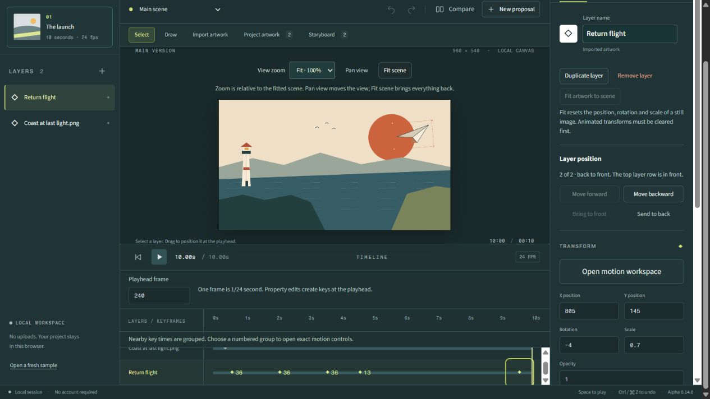

The groups adapt to the available width, with 44-pixel targets checked at desktop and 319 pixels. Isolated keys still navigate directly. These are overview controls; use the motion workspace to inspect individual keys.

## Inspect motion one frame at a time

Use **Previous animation frame** and **Next animation frame** in the motion workspace to check a landing, a turn or an easing preview precisely. Stepping stops playback and stays within the scene. The controls work with the keyboard and remain reachable on narrow screens.

The evaluator now scans property keys once instead of sorting them on each evaluation. A retained 96,400-key fixture preserves exact numeric results and six rendered pixel hashes. On one browser, the isolated candidate used about 42% of the older evaluator’s measured CPU time; this is not a whole-editor frame-rate guarantee. [Evidence and limits](TESTING.md#dense-motion-and-frame-stepping--0130)

## Architecture and ownership

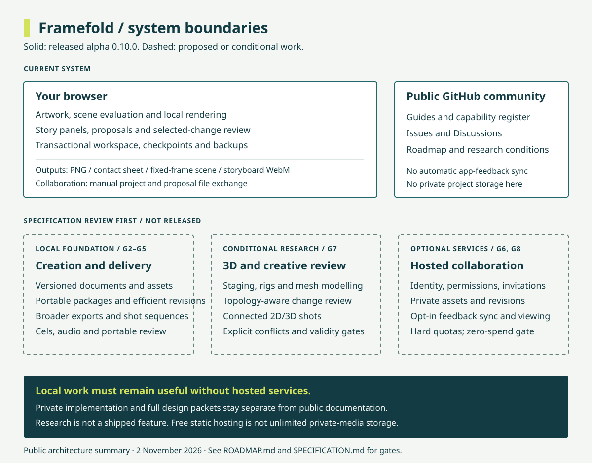

Today, editing and rendering happen in the browser. People exchange project/proposal files themselves. GitHub hosts the public documentation and discussion; it is not a project-storage or animation-review backend. [Architecture and limits](docs/ARCHITECTURE.md)

The operating constraint is **zero hosting spend**. Local creation/export must remain useful without a service account. Hosted storage, invitations, GitHub feedback sync and audience playback links are conditional on viable free allocations and enforceable limits. There is no promise of unlimited media delivery or free global scale. [Budget rules](docs/ARCHITECTURE.md#zero-spend-boundary)

This is a public documentation and community repository, not the application source. GitHub permits forks of public repositories, including this one. Private source access is separate, and browser-delivered application code can still be inspected. The repository licence does not grant rights to the private implementation or third-party artwork.

## Participate

- [Discussions](https://github.com/ismaeelakin/framefold-community/discussions): artist workflows, questions and work you can safely share.
- [Bug reports](https://github.com/ismaeelakin/framefold-community/issues/new?template=bug_report.yml): reproducible failures in the released alpha.
- [Workflow requests](https://github.com/ismaeelakin/framefold-community/issues/new?template=feature_request.yml): the task and outcome a feature should support.
- [Research proposals](https://github.com/ismaeelakin/framefold-community/issues/new?template=research_proposal.yml): a bounded experiment with evidence and a stop condition.
- Documentation pull requests: corrections, clearer guides and reproducible public examples.

Read [contributing](CONTRIBUTING.md), [community rules](CODE_OF_CONDUCT.md), [privacy](PRIVACY.md), [security](SECURITY.md) and [release notes](CHANGELOG.md). Public attachments can be read by anyone; share only material you have permission to publish.

Maintained by [Ismaeel Habeeb](https://github.com/ismaeelakin). No release date, adoption, investment or acquisition is guaranteed. Framefold remains a working name.
