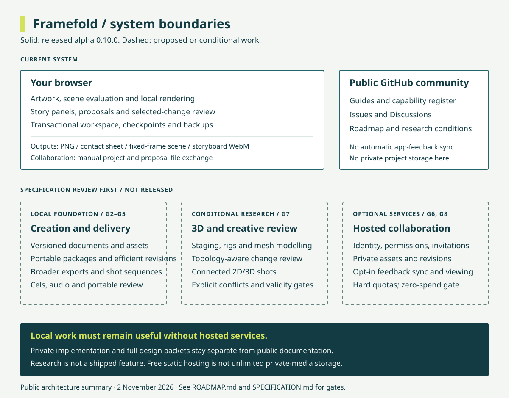

# Architecture and operating boundaries

This page separates the **released alpha** from **proposed architecture**. The diagram uses solid borders for the current system and dashed borders for future work.

## Current system: alpha 0.3.0

The static website loads into a browser. Local project state contains the approved scene, proposals, embedded artwork and story panels. Scene evaluation supplies the same drawing path for preview and local exports. Review compares a proposal's base/draft against current approved content and asks for explicit decisions on overlapping changes.

Persistence uses browser-local storage and downloaded JSON files. Scene and approved-storyboard WebM use fixed-time frame enumeration and a lazy-loaded local WebCodecs/Mediabunny muxing path. It has been decoded and timed in Chromium; broader codecs/browsers and longer sequence tools remain pending. The storyboard UI exports up to3,120 frames/130seconds using approved panel holds; exact boundary samples have been checked. Project/proposal exchange is manual. GitHub discussions and issues are separate public community records; app feedback is not automatically synchronized there.

The primary address is [framefold-psi.vercel.app](https://framefold-psi.vercel.app/). The old Sites address retains a working deployment for continuity. Each origin has separate local storage; download and reopen projects to move them. The old-site migration-notice update remains blocked by a source-host connection failure; no automatic redirect is in place.

## Proposed local engine

- A versioned document core with stable identities, frame-based time and validated operations.
- Separate evaluation and rendering boundaries shared by preview, review and export.
- Content-addressed assets, atomic local saves, checkpoints and portable packages.
- Immutable alternatives, dependency-aware review and conservative conflict handling.
- Bounded rendering jobs with cancellation, format checks and resource preflight.
- Optional 3D geometry, rigging and shot bridges, admitted through research gates.

These are design boundaries. IndexedDB migration, fixed-time encoded video, the 3D kernel and their libraries are not implemented or selected merely by this plan.

## Optional services

Authentication, memberships, invitations, shared assets, hosted revisions, GitHub issue synchronization and audience links require an optional service boundary. Every remote read/write needs server-side authorization. Private media must not become a public bucket or an accidental GitHub attachment. The renderer and local file format must not depend on a particular hosting provider.

## Zero-spend boundary

No paid hosting, metered overage, automatic plan upgrade, purchased domain or rented render worker is authorized. Editing and rendering should use users' devices; exported media stays local unless they explicitly share it. This reduces operating costs but does not promise unlimited client capacity or website availability.

The existing Vercel Hobby deployment is subject to its current allocation and personal/non-commercial terms. A free static-host option can be evaluated before a commercial launch. Cloudflare Pages documents free unlimited static-asset requests; its functions, deployment limits and media storage remain separate concerns. No host migration is announced by this page.

Any hosted pilot needs a provider worksheet covering storage, requests, egress, retention, commercial terms and hard stops. At exhaustion, remote operations must stop gracefully without a billable fallback; local editing/downloads remain useful. Unlimited global media delivery is not part of the budget contract.

Provider references, checked 31 October 2026: [Vercel Hobby](https://vercel.com/docs/plans/hobby), [Cloudflare Pages pricing](https://developers.cloudflare.com/pages/functions/pricing/), [Pages limits](https://developers.cloudflare.com/pages/platform/limits/).

## Public and private material

This repository contains public documentation, approved screenshots and community templates. Implementation source and full engineering packets remain private. Public participation does not grant access to private projects. Public repositories can be forked; the source privacy boundary is the separate private application repository.
