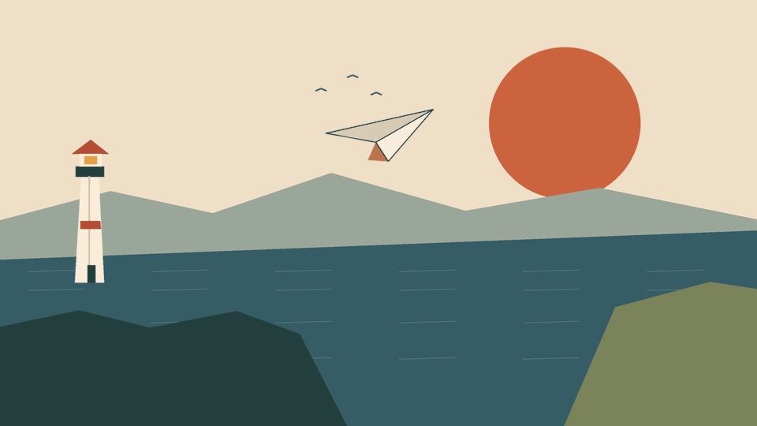
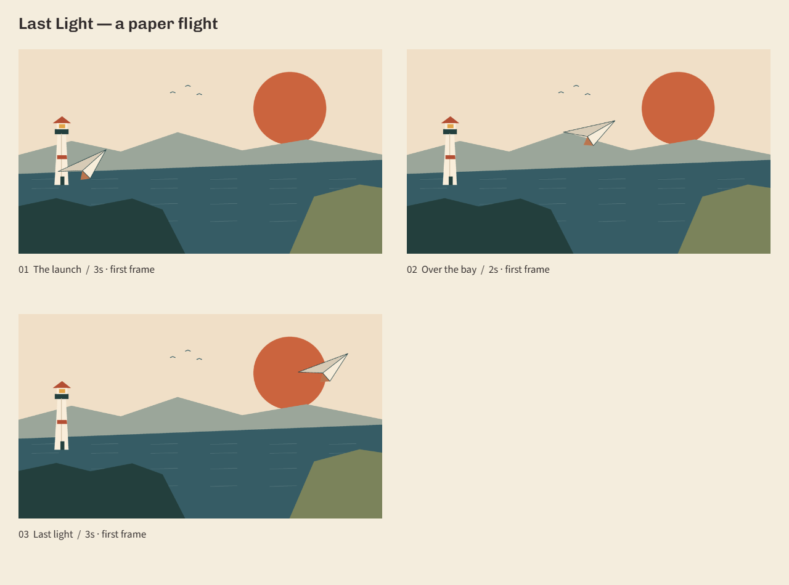

# Last Light

An original paper plane crosses a coastal landscape at sunset. This complete sample uses the released browser alpha: imported artwork, position/rotation keys, three story panels and editable alternatives.

[Download the editable project](https://framefold-psi.vercel.app/learn/last-light.html#download) · [Watch/download the scene WebM](https://framefold-psi.vercel.app/learn/last-light.html#scene) · [Open Framefold](https://framefold-psi.vercel.app/#studio)

## Open it

1. Download the editable JSON project above. Keep your own current project backed up first.
2. Open Framefold and choose **Open project**, then select that JSON file. Both artwork images are embedded; no account or image upload is needed.
3. Select **Paper flight**. Move the playhead to 0, 5 and 10 seconds to inspect its three poses. Press Play.
4. Choose **Storyboard**. Use **Play animatic**, the time slider and Restart to inspect The launch, Over the bay and Last light.
5. The imported **A higher crossing** proposal still contains an unapplied rotation change. Open it in the proposals panel to review what was retained and what remains.
6. Choose **Proposal: Wind marks — drawing study** in the version menu to inspect the separate drawn stroke and beacon shape. Main stays intact.
7. Make your own proposal, rename a layer in Properties and try a different movement. Download your project to keep it.

## What the files represent

The project holds the approved scene, two captured panels and two proposals. The scene WebM is the accepted version before the separate drawing study; the drawing study is deliberately not applied to main. Scene video is silent, 960 × 540, 240 frames at 24 fps, 10 seconds. The storyboard holds are 3/2/3 seconds; Complete storyboard video is available in0.3.0.

This is project data and original artwork, not the private application source. The material is distributed under this repository's existing [MIT license](../../LICENSE). No third-party artist assets are included.

## Verified scope

Actual browser-created/downloaded checkpoints were reopened on another local origin. Eleven source assertions, six encoding/failure-path checks and six actual-editor download/decode checks passed in Chromium 155. That is one-browser operator evidence, not independent artist usability, clean-device recovery or a guarantee of identical results on every browser. Use the [reporting guide](../../TESTING.md) for problems.

A full tools-and-navigation video series is planned. The WebM here is artwork playback, not that future walkthrough.

## Complete storyboard output (0.3.0)

[Download the approved storyboard WebM](last-light-storyboard.webm): three panels, holds3/2/3seconds,192 decoded frames at24fps. This is an actual editor export while a proposal was selected; the output uses the approved scenes. It is finished artwork output, not a navigation demo. Current maximum is thirteen panels/130seconds; each editable scene remains ten seconds.
